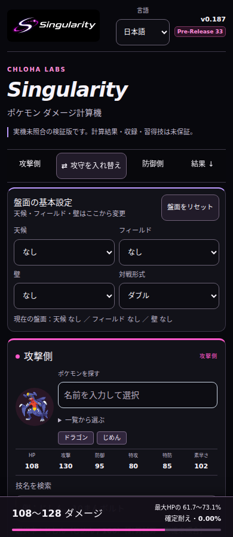
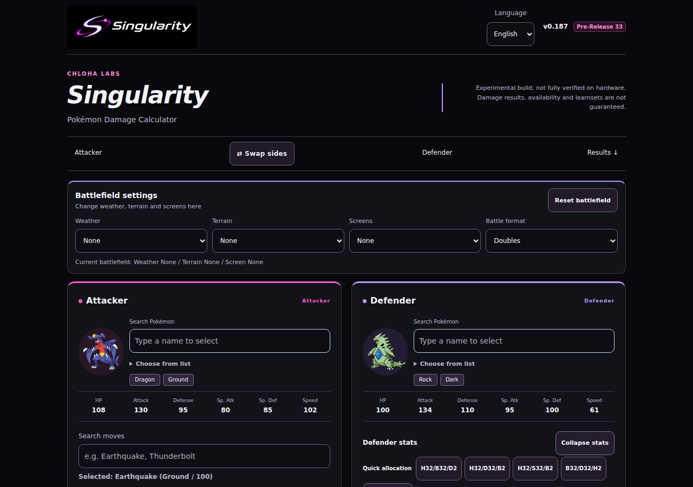

# Singularity v0.187 — デザイン確認用

**2026-11-15に名称・ロゴ・UIの採用と公開工程が承認されました。実URLの受入・切替は別途検証します。** [承認範囲](v0187-owner-approval.md)。製品はSingularity、開発元はChloha Labs。元画像のOrbital Sを保持し、ブラック・ホワイト・ネオンピンク・パープルの表示層を計算処理から分離しています。

以下はGitHub CIの実ブラウザ画像で、生成したUIモックではありません。画面ソースは `4410036663748cdc04e5feb7a59066af75200c01`、[検証run](https://github.com/Kurohanolu/chloha-damage-lab/actions/runs/43611635903)。PRの一時マージ参照で検証されるため、成果物に記録したcheckout SHAとPR head SHAは区別します。後続の資料更新は同じUI・計算処理を保持します。

## スマートフォン：日本語

390×900。言語欄は44px以上、ロゴ・言語欄・版番号の重なりを検査しています。

## PC：英語

1280×900。攻撃側・防御側の入力、技検索、盤面条件を維持しています。

## 計算結果・任意添付・狭い画面

- [日本語の計算結果](v0187-preview/mobile-ja-result.png)
- [フィードバックの添付確認・プライバシー表示](v0187-preview/feedback-attachment-ja.png) — ローカルテストの技術情報です。本番報告の送信・個人情報の取得は行っていません。
- [320px幅のドイツ語表示](v0187-preview/mobile-de-320.png)

9言語の表示・切替・再読み込み・検索・入力維持・数値一致と、既存フィードバック画面の9言語検査はCIで実行しています。全端末・全ブラウザの実機検証を意味しません。

## ロゴ4形式

| 用途 | 試作ファイル | 扱い |
|---|---|---|
| 正式ロゴ候補 | [元画像PNG](../assets/singularity/orbital-s-reference.png) | 添付された1536×1024の画像を変更せず保存 |
| 正方形アイコン | [512px WebP](../assets/singularity/orbital-s-icon.webp) | 文字を除いた派生案 |
| 横長ヘッダー | [600×200 WebP](../assets/singularity/header.webp) | コンパクトな横組み派生案 |
| Favicon | [64px PNG](../assets/singularity/favicon.png) | 派生アイコンの小サイズ書き出し |

[180px PNG](../assets/singularity/apple-touch-icon.png)も用意しています。[生成・書き出し条件](../assets/singularity/README.md)を記録しました。元画像以外の曲線・文字形状・光彩は完全一致を保証するものではなく、正式採用には確認が必要です。既存の公式ポケモンロゴは組み込んでいません。

必要な追加表示ファイルは62,557bytes（元の画面データを除く、このチェックポイントの新CSS・ブランドJS・ヘッダー・Favicon・180pxアイコン合計）。大きな元画像はロゴ確認ページで使い、計算画面の背景には読み込みません。外部フォントや演出用ライブラリは追加していません。

## 採用後の公開工程

名称・ロゴ・画面デザインの採用と新リポジトリ/Pages設定・新URL公開・mainマージは承認済みです。画像はレビュー時の実ブラウザ記録で、商標調査の限界と派生ロゴの再現上の限界は維持します。実際の配信・本番受付の受入結果は[開発/公開準備状況](v0187-release-readiness.md)とPR #64に分けて記録します。
