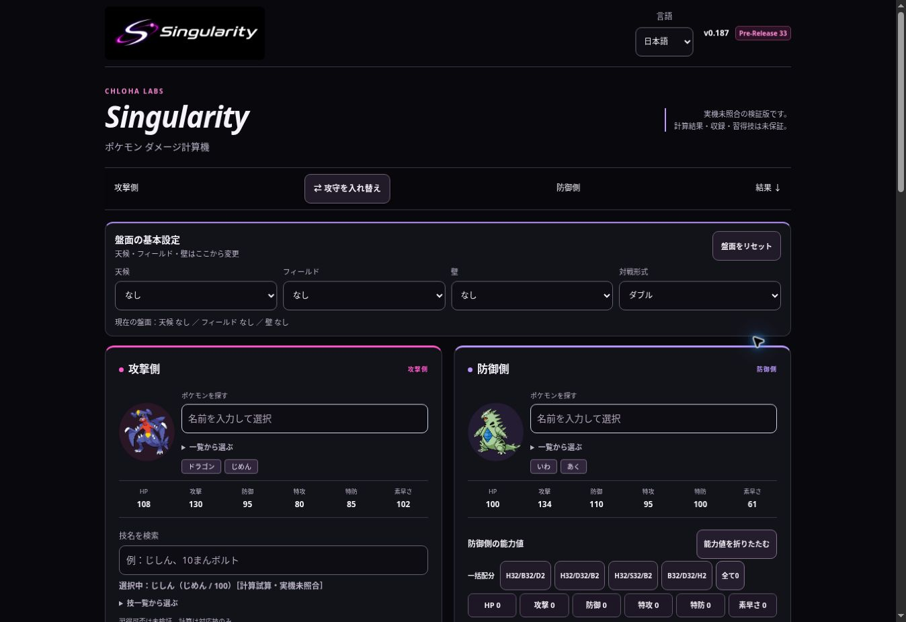

# v0.187 actual-site acceptance checkpoint — 2026-11-15 JST

**New URL is live for acceptance. Formal release/main merge and the old-site notice are not complete.** The owner has already authorized the rollout; the remaining blocker is completion of the protected administrator sign-in and real moderated Issue round trip, not missing publication permission.

| Evidence | Actual result |
|---|---|
| New URL | `https://kurohanolu.github.io/singularity/`, title `Singularity v0.187 Pre-Release 33` |
| Deployed source | `d33776be1f24c20793be88527d20189954d73052`, all ten source workflows successful |
| Canonical deployment implementation | `2123237dc74f131bee2ff4caea7d39b7a28aa7d1`, all ten source workflows successful |
| Target workflow | `Kurohanolu/singularity@481f2a2d847a0d66487f10dacf56b1865392adc1`, byte-identical to the canonical source template |
| Actual new-site deployment | [Run43648999989](https://github.com/Kurohanolu/singularity/actions/runs/43648999989), build and deploy completed/success; provenance artifact retained |
| New-site hashes | All37 required public files match the clean approved-source artifact, including all original runtime scripts and supplied/adapted logos |
| Real browser locales | Japanese, English, French, German, Spanish, Italian, Korean, simplified and traditional Chinese; visible product heading always Singularity and product explanation localized |
| Numeric/input/reload | Default damage108–128 and attacker Attack165 retained during all locale changes; English retained after actual reload |
| Real anonymous intake | Existing production Turnstile-backed form displayed its private-report received-success message; no email or optional calculation snapshot supplied |
| Persistence | Authenticated read-only D1 query, restricted to the exact synthetic test description, confirmed one matching record: v0.187 Pre-Release33, locale en, status New, no Issue yet. No database row was changed by verification |
| Existing security readiness | All ten actual read-only checks pass; all three administrator paths redirect anonymous requests to the existing Access issuer. An earlier unconfirmed `/admin/` check was investigated and not treated as success |
| Old-site source | `pages-legacy`/root, `aac68ac8eb7a23a72f91d8045833baadd97ec0c3`; [run43647174221](https://github.com/Kurohanolu/chloha-damage-lab/actions/runs/43647174221) successful; all30 old HTML/manifest/runtime files match v0.186 |

The uniquely labeled synthetic test is `migration-v0187-d33776b-20261115`. Its receipt text is synthetic technical data, not a real user's feedback. No existing private descriptions, emails, credential values or signed authentication URLs are copied into this report. The synthetic record is retained for audit and normal expiry; no production data deletion is performed.

## Actual public screen

This is a screenshot of the actual HTTPS site, not a generated mockup. Review-time mobile/browser regression evidence remains in [design previews](v0187-design-preview.md).

## Administrator handoff and remaining work

The protected administrator URL redirects to the existing Access application, which offers Cloudflare sign-in. A secure browser credential request did not establish a confirmed login. A fresh independent administrator tab still showed the Access sign-in page. No application credential/session value was read, copied to chat or committed, and no authentication setting was changed.

After the owner completes sign-in in the shared browser, inspect only the labeled synthetic record; verify Accept/status handling, preview and explicitly approve a technical-only synthetic Issue, then confirm its Issue link and duplicate-prevention state. Do not copy the private description/email/snapshot to a public Issue. Do not create an Issue through a different route and claim that it proves the Worker's integration.

Only after those real-service checks pass, record full acceptance, set `liveTargetVerified=true`, rerun exact final-head CI and dispatch the approved final source SHA to the new target. After final PR-base CI, deploy the old-site notice, verify both exact public trees, merge the approved PR and verify exact-main CI/immutable publication. Until then main remains `4b2cde61f92610c5bb970618d34147a2c16a8d7b`, the old calculator works without a forced redirect, and the actual-target flag remains false. Follow the [cutover/rollback runbook](v0187-cutover-runbook.md).
