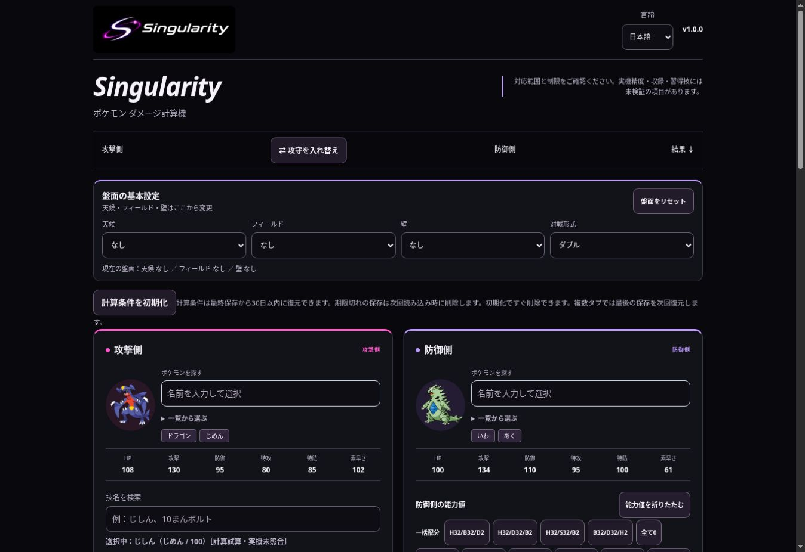

# Singularity v1.0.0 Final Release Report

**Stable release published on 2026-11-15, 19:06:21 JST. Quality disposition: CONDITIONAL READY, with the disclosed limitations accepted under the owner's explicit publication delegation.** This is not a claim of complete Champions hardware accuracy or an unrestricted product-wide PASS.

Final evidence closure: completed. Independent 6.1 Sol verdict: **publication integrity PASS within the reviewed scope**, while the original conditional quality limitations remain explicit. The exact final review and raw evidence are preserved with this report.

## 1. Release identity and actual publication

| Item | Verified value |
| --- | --- |
| Product / developer | Singularity — Pokémon Damage Calculator / Chloha Labs |
| Released source / tag commit | `0b270c1452505268364659edd402209b00b28673` (M) |
| Released Git tree | `239c4cbd37aa6389f16dc81e7f9a861c09a723f2` |
| Current main after a separate documentation update | `1e3fc5390de5332a0470298835973a9f470ccaea`; tree `44d20dcb7d2a5c60e03bad3fc9a4ce6184fbcd49`; released code/assets unchanged |
| Source PR | [#67, merged](https://github.com/Kurohanolu/chloha-damage-lab/pull/67) |
| Stable tag | [`v1.0.0`](https://github.com/Kurohanolu/chloha-damage-lab/tree/v1.0.0), resolves directly to M |
| GitHub Release | [Singularity v1.0.0](https://github.com/Kurohanolu/chloha-damage-lab/releases/tag/v1.0.0), ID 445961829, draft=false, prerelease=false, Latest |
| Current URL | https://kurohanolu.github.io/singularity/ |
| Legacy URL | https://kurohanolu.github.io/chloha-damage-lab/ |
| Final target deployment | [43702512270](https://github.com/Kurohanolu/singularity/actions/runs/43702512270), exact M, attempt 1, all build/deploy steps successful |
| Target workflow source | `cede7831cc010fe5ad46e8c30a67e39a509474f0`, merged [target PR #1](https://github.com/Kurohanolu/singularity/pull/1) |
| Distribution ZIP | `v1.0.0.zip`, 2,879,887 bytes, 413 files |
| ZIP SHA-256 | `dda8fdaaa2f0eab02fae16072cc2fa6e5185cd5e92b84134ab3e81ccdb7791c6` |

Root and 6.1 Sol separately downloaded the published ZIP and checksum, verified API digests and CRC, checked the commit comment and every source path/byte, and regenerated the UTC Git archive byte for byte. The release body agrees with the committed Japanese release notes, M and its eleven successful main-push workflows. Existing tags were not overwritten. The final audit is stored on a separate evidence branch so the released source/tag/archive remain immutable.

## 2. Source chain and owner authorization

| Stage | Commit | Tree / purpose |
| --- | --- | --- |
| Previous public source / rollback | `4f068544e670a85a6a4d34dd2c26e2be66bd9cb7` | `cf7af9334261b0cfbbde45929da9d217445fe526`; immutable `v0.188-pre.1` |
| Audited v0.188 candidate | `c9c52e1f7598fa6f7642a784a88e9bc3a4c7e095` | `bcf11e2ce7b2ff9a74db62309a33c0e3032a3c2b` |
| Independently reviewed stable R2 | `b5ea506af27487a05cc7fbdc11371ac47778b06a` | `1e4d0d54c2013b22db3e15db144f8998cab1adfd` |
| Approved A | `de5ec8342d974a07e2d155f0293851c69087ff94` | `c99f29d54673bb5abf97a2da3d771fef6485a34b`; approval/docs only |
| Actual acceptance B | `56633de643e8a13d5e0f26c1aa2b5b2bcc278232` | `239c4cbd37aa6389f16dc81e7f9a861c09a723f2`; actual A receipt plus docs |
| Release merge M | `0b270c1452505268364659edd402209b00b28673` | Exactly B's tree; parents previous main and B |

The [prior v0.188 final gate report](https://github.com/Kurohanolu/chloha-damage-lab/blob/be01f25ae9597b16551a5fa963e093b2247eff9f/docs/v0188-final-release-gate-report.md) is preserved on its original evidence branch. It does not substitute for fresh v1.0.0 CI.

The owner explicitly instructed 「公開まで進めてくれ」 and 「リリースまで頼むぞ」 after specifying the known limitations and conditional release framework. [Owner decision](v100-owner-decision.md) and [structured approval](v100-owner-approval.json) record delegated publication, not a claim that the owner manually typed a future SHA. The immutable original Sol review SHA-256 remains `57e0d95c594797b150af33e129cb0c756de9ae1d8648656dfddf6bfa8d1feb82`.

A subsequent, separate operation added 18 idea-backlog lines only to `docs/development-memo.md` on main, commit `1e3fc5390de5332a0470298835973a9f470ccaea`, directly parented by M. This release task did not create it. Root and Sol independently verified this as a post-release documentation update; no new mechanic, language or roadmap commitment is inferred from its contents. The complete 76-file public build map remains identical. The released tag/Release/ZIP deliberately stay at reviewed M; no tag is moved to the later documentation commit. See the [reference-drift evidence](evidence/v100/post-release-main-docs-proof.json) and [independent addendum](evidence/v100/v1-sol-postrelease-docs-addendum.md). All other 412 tracked blobs are identical. M CI is not claimed as a run on N.

All 307 protected files are byte-identical from R2 through A/B/M. B changes only five permitted acceptance fields plus docs relative to A. The main merge used an expected-head lease. No unexplained engine change or unreviewed source substitution occurred.

## 3. Numerical accuracy and declared mechanics

The engine/model/data remain unchanged from audited c9c. Fresh exact-M promotion tests pass **4,520 complete output comparisons**, comprising:

- 300 original contracts: 269 unchanged, 26 documented historical numeric corrections and five trace/metadata corrections. Original fixtures and correction justifications remain locked.
- 72 Brick Break/Psychic Fangs screen witnesses, including format, critical and rank combinations.
- 28 Electro Ball/Gyro Ball speed boundaries checked with independent neutral BigInt arithmetic.
- 2,048 fixed-seed inputs through both entry points: 4,096 comparisons.
- 21 complete multihit distributions.
- Three comparisons preserving two declared unsupported behaviors: multihit Multiscale rejection, and Raging Bull without/with Reflect. These three comparisons explain the difference between the previously abbreviated component list and the total 4,520.

All sixteen random rolls are compared where applicable; there are **zero unexplained numerical differences**. Existing Showdown differential, locked-reference, independent arithmetic, baseline, immunity and boundary tests remain enabled. The fresh quality suite also reruns the prior continued/Astra engine witnesses.

C-E01's representative Brick Break 76–90 and Psychic Fangs 42–50 results are conditional witnesses, not universal move values. Manual HP/Speed, Electro Ball, Gyro Ball, Foul Play, automatic/manual transitions and reload consistency are covered. Raging Bull screen breaking remains unsupported. Showdown parity and browser regression are not Champions physical-game verification.

Raw evidence: [promotion comparisons](evidence/v100/final-m/stable/engine-promotion.json), [stable runner](evidence/v100/final-m/stable/test-run.json), [continued engine](evidence/v100/final-m/quality/reports/v0188-continued/engine.json), [independent mechanics](evidence/v100/final-m/quality/reports/v0188-astra/engine-independent.json).

## 4. Nine languages, state, UI and feedback

Japanese, English, French, German, Spanish, Italian, Korean, Simplified Chinese and Traditional Chinese retain the same stable identity, localized scope warnings, names/search, variable-power labels, errors, forms, image alternatives, language persistence and numerical outputs. The tests preserve **90 language transitions**, **54 locale/viewport combinations**, and **18 additional search combinations**. Tested widths are 320, 360, 390, 430, 768 and 1440 px. The fresh quality runner passes **34/34 test files**, with every exit zero.

State coverage includes Foul Play raw98/effective66, automatic allocation and transition to manual mode, HP/Speed, move changes, reload, malformed/expired/schema-invalid storage, access denial/quota, reset, multiple-tab semantics and the privacy allowlist. Feedback text, contact, authentication material and private snapshots are excluded from automatic calculator-state storage.

Feedback coverage includes changed inputs, changed or vanished numerical results, expired attachment consent, final submission recheck, language-only changes and duplicate/retry protection. The stable adapter explicitly maps only v1.0.0 to wire v1.0, while showing and always storing the complete v1.0.0 in fixed report-body metadata. Its 31-code-unit prefix leaves a 4,969-unit user-input budget within the unchanged 5,000-unit backend limit; unknown future patches fail closed. The app_version database column alone is not full patch identity. No Worker/schema/authentication change was needed.

Fresh local browser/Worker/SQLite tests pass 18 cases (nine languages × attachment on/off), 36 local POSTs including retries, and 18 synthetic stored reports. **No production report or Issue was created.** Keyboard checks cover first ArrowUp, active-descendant cleanup, Escape, focus and synthetic IME. The formal Orbital S logo and Chloha Labs developer credit remain; no separate top-level CHLOHA LABS heading was restored.

Post-M Pages run [43701633760, attempt 2](https://github.com/Kurohanolu/chloha-damage-lab/actions/runs/43701633760), latest job 132776763989, passed after the exact-M deployment. It checks actual public nine-language reload, manual Speed/HP, sixteen rolls and feedback readiness/consent without a production submission. Physical phones, native screen readers/OS IME, exhaustive contrast and professional review of every translated sentence remain unverified.

Raw evidence: [stable feedback](evidence/v100/final-m/stable/feedback-browser.json), [state](evidence/v100/final-m/quality/reports/v0188/continued-state-browser.json), [search/locales](evidence/v100/final-m/quality/reports/v0188/continued-locale-browser.json), [viewport UI](evidence/v100/final-m/quality/reports/v0188/ui-mobile.json), [accessibility](evidence/v100/final-m/quality/reports/v0188-final/accessibility.json).

## 5. Performance and finite memory

The [final-M performance supplement](v100-final-m-performance-summary.md) and [recomputed JSON](v100-final-m-performance-summary.json) retain sample counts, medians, ranges, IQRs, environments and artifact digests. The raw M files are committed under [evidence/v100/final-m](evidence/v100/final-m/), so they survive Actions artifact expiry. R2 measurements are not reused as final-M evidence.

For the same-candidate C-P01 guard reversal, five contexts × 20 inputs gives 100 timings per variant/profile. Mobile 390px/4×CPU median is **64.55 → 21.25 ms**, range 57.50–85.30 → 18.00–38.10, IQR 6.40 → 2.40. Desktop median is 17.45 → 16.60 ms. Calculator mutation records fall **400 → 0** per profile; complete input, damage rolls, saved bytes and feedback text remain unchanged. This isolates one guard, not the entire old/new release.

For baseline v0.188-pre.1 versus M, five alternating contexts × 12 operations gives n=60 per metric/profile. Calculation medians are desktop 20.50 → 21.80 ms and mobile 76.00 → 75.15 ms; locale switching 50.05 → 53.25 and 197.05 → 191.95 ms. Ranges overlap. No statistical significance or universal performance improvement is claimed. Shaped mobile cold loading remains roughly 10.5 seconds; external services are blocked equally in the loopback comparison. Public CDN measurements are separately labeled.

Controlled GC covers 12 contexts, 96 rounds including 24 warmups, 72 measured rounds and 36 reload checks. All **13,248 sampled retired probes** are collected with correct calibration controls, zero aged sampled survivors and no scenario failures. Median post-GC heaps baseline→M are 4,776,656→4,755,900 bytes desktop and 4,843,802→4,798,872 mobile. Positive first-to-last measured growth remains +25,848/+25,632 bytes in M. Six measured checkpoints span only 7.24–28.62 seconds per context, despite a 369-second complete harness. Document/node/listener/connected-element counts are stable during measured rounds; 16 detached OPTION trees remain in both versions without proven retaining-path equivalence. This is **not** an hours-long soak, heap-plateau proof or guarantee of no leak. Uncontrolled heap increases are reported separately.

## 6. Cloudflare and privacy boundary

Existing anonymous feedback, Turnstile and administrator protections are maintained. The publisher's original production-readiness check passes. Safe GET-only checks verify configuration readiness, exact allowed origin, private/no-store caching, Access redirects on three administrator paths and rejection of public report listing. Existing public Issue #65 linkage was inspected without publishing private information. No production feedback/Issue, private report read, secret disclosure, D1 deletion, Worker deployment, Access change or authentication relaxation occurred.

The normal Cloudflare dashboard reached a sign-in wall; no authenticated management connection was available and no bypass was attempted. Current management configuration, deployed Worker bytes/bindings, private D1 linkage, real Turnstile challenge completion and actual backend rollback remain **INCOMPLETE**. Public boundary evidence does not prove those management settings.

One post-A configuration fetch initially failed with an unclassified exception; the full original checker repeated with identical options passed 10/10. One independent final-M asset sweep hit an unclassified 15-second timeout; a full repeat with unchanged fetch options passed. Both attempts remain in the sanitized evidence. No cause or production outage was established, and no protection workaround was used. See [feedback check](evidence/v100/v100-feedback-post-cutover.json) and [independent asset diagnostic](evidence/v100/v1-sol-m-live-diagnostic.json).

## 7. Deployment, public assets and release chronology

A was deployed by [43699852774](https://github.com/Kurohanolu/singularity/actions/runs/43699852774), independently accepted, and its actual receipt was committed as B. B was deployed by [43701204652](https://github.com/Kurohanolu/singularity/actions/runs/43701204652); all eleven fresh B workflows and a post-B browser rerun passed. Root and Sol separately passed complete 76-file/219-request HTTP/SHA-256 sweeps for A, B and M content. Inventories include HTML, JavaScript, CSS, branding/favicon assets, release metadata, dynamic references, empty .nojekyll files, and exact browser cache URLs: 43 current files/123 requests plus 33 legacy files/96 requests.

M has exactly B's accepted tree. After all eleven fresh main-push workflows succeeded, the publisher rechecked actual deployment provenance and every current public byte immediately before releasing at 10:06:21 UTC. At that moment the live build was B, byte-identical to M. The exact-M target deployment then completed at 10:07:52 UTC; it aligned source provenance without changing public bytes. Its provenance artifact 14157331748 has ZIP SHA-256 `c408f3065f79f0683867b77c4fb32ece009e11235cd0b47ada4a98276ec5c50a` and independently matches M's complete 76-file build map. Post-M browser acceptance passed as described above. Root then repeated all 76 files/219 HTTP and SHA-256 checks at 10:10:58.873 UTC with zero production mutations; [the complete receipt](evidence/v100/v100-live-public-assets-m-postdeploy.json) is retained. Sol checked every observation against his independently generated expected map, source/tree and deployment time. His own independent full M-content network sweep is separately recorded; it is not mislabeled as a second post-M-deployment network run.

The target workflow is the reviewed 5,479-byte template, SHA-256 `60e32190a7cee9e88bb6466ccfd8bec518d1978a32bee1d3b66c3ee363d599fa`. The public repository remains deployment administration, not a separate engine. The earlier static audit also checked 371 external sprites and embedded images; external content is mutable and its ongoing availability is not guaranteed by the repository hash inventory.

Source GitHub Pages settings were directly inspected: branch `pages-legacy`, root, HTTPS enforced. The legacy branch remains `1f9612cf1e2b7d4d6581e6acf24b9291d5e465f1`, with its existing v0.186-pre.32 calculator plus migration notice. It is not falsely labeled as the v1.0.0 runtime. Its HTML SHA-256 remains `16088457d9e9ce1089980312fb6a98bbfa2b97b8bf1334b6ccfa93ec7cb4b454`.

## 8. Exact-main CI

All workflows below target M, branch main, event push. Every current job and step is successful; no important test is skipped or disabled. Pages attempt 2 is the additional post-M-deployment rerun. The publisher is additional to the eleven required workflows.

| Workflow | Run | Result |
| --- | --- | --- |
| Damage Lab CI and status ledger | [43701633811](https://github.com/Kurohanolu/chloha-damage-lab/actions/runs/43701633811) | PASS |
| GitHub Pages live smoke | [43701633760](https://github.com/Kurohanolu/chloha-damage-lab/actions/runs/43701633760) | PASS, attempt 2 |
| Showdown differential audit | [43701633934](https://github.com/Kurohanolu/chloha-damage-lab/actions/runs/43701633934) | PASS |
| Showdown differential tests | [43701633835](https://github.com/Kurohanolu/chloha-damage-lab/actions/runs/43701633835) | PASS |
| UI & damage regression | [43701633783](https://github.com/Kurohanolu/chloha-damage-lab/actions/runs/43701633783) | PASS |
| v0.184 engine baseline | [43701633794](https://github.com/Kurohanolu/chloha-damage-lab/actions/runs/43701633794) | PASS |
| v0.185 anonymous feedback | [43701633745](https://github.com/Kurohanolu/chloha-damage-lab/actions/runs/43701633745) | PASS |
| v0.186 Accuracy & Mechanics Audit | [43701633859](https://github.com/Kurohanolu/chloha-damage-lab/actions/runs/43701633859) | PASS |
| v0.187 Singularity Migration | [43701633879](https://github.com/Kurohanolu/chloha-damage-lab/actions/runs/43701633879) | PASS |
| v0.188 Quality Remediation | [43701633753](https://github.com/Kurohanolu/chloha-damage-lab/actions/runs/43701633753) | PASS, all three jobs |
| v1.0.0 Stable Promotion | [43701633773](https://github.com/Kurohanolu/chloha-damage-lab/actions/runs/43701633773) | PASS |
| Publish verified release | [43701633755](https://github.com/Kurohanolu/chloha-damage-lab/actions/runs/43701633755) | PASS, actual stable publication |

Root's [complete CI/job/step receipt](evidence/v100/root-main-ci-proof.json) and Sol's independent proofs preserve the exact source association. Exact-M stable artifact 14157355167 has SHA-256 `1ee617e0fca4a5d04b8397bed6579d047d0ebdbf8a8df7f7997cf0cf2b17be4d`; quality 14156239034 `e4ed87344fa7ec4e17e081f6293d49517a8eb040d11c90845d12b6b27ff3f7f4`; performance 14156382851 `236eaf31f4fb4ed26ac0d58a29aa64e04aa4d251fb5dbb3704803dbf03092b3b`; memory 14156802797 `a3207d24b6dadce951a49049382ba3f727f1296a77aa0dfb9acf7296d85efa2f`.

## 9. Findings and corrections

| Finding | Priority | Resolution |
| --- | --- | --- |
| C-E01, wall-breaking moves | High | Prior audited fix retained and freshly tested; no repeated implementation. |
| C-S02, manual Speed/HP routing | High | Prior audited fix retained; speed-dependent rolls and reload parity verified. |
| C-S01 / SOL-02, Foul Play and allocation transitions | Medium | Existing raw/effective and automatic/manual boundary corrections retained. |
| SOL-01, stale feedback attachment consent | Medium | Existing freshness and null-result protection retained and retested. |
| C-U01, first ArrowUp / active descendant | Medium | Existing keyboard/accessibility correction retained. |
| C-L01 / C-L02, variable power and unsupported warnings | Low | Existing nine-language corrections retained; scope not overstated. |
| C-P01, unnecessary calculator DOM updates | Low | Existing guard retained; fresh M causal experiment confirms reduction. |
| SOL-V100-01, stale publication-time byte check | Medium | Publisher now refreshes all public bytes after its potentially lengthy CI wait, immediately before publication. Ordering regression test passes. |
| R1 historical feedback length expectation | Test defect | R1 failed because a prior test expected 5,000 rather than the deliberate stable 4,969-unit user budget. R2 corrects only two version-dependent expectations and asserts actual sent/stored full metadata. No runtime masking, disabled test or reused failed CI. |

No unresolved Critical or High was found within the reviewed declared scope. Earlier failures are retained in chronological records; they were not relabeled as successful.

## 10. Recovery and remaining work

The immutable `v0.188-pre.1` tag still resolves to `4f068544e670a85a6a4d34dd2c26e2be66bd9cb7`. Its Release ZIP was freshly downloaded and verified: 2,530,855 bytes, SHA-256 `60ec01af456a251eec006833ade16bddf5b5ef8e209c939d518879ebb2f4d500`. Notice-free legacy recovery source is `4b2cde61f92610c5bb970618d34147a2c16a8d7b`. Recovery is non-destructive redeployment under the [promotion/rollback runbook](v100-promotion-runbook.md); no rollback was necessary. Existing D1 and authentication are preserved.

| Area | Final assessment / limitation |
| --- | --- |
| Declared code/mechanics, exact-source CI and public artifact integrity | PASS within tested scope |
| Nine languages, state, feedback and emulated UI | PASS within finite automated/browser coverage; not exhaustive linguistic/physical certification |
| Cloudflare public boundary | Safe read-only checks passed; no configuration changes |
| Cloudflare authenticated management/private linkage/backend recovery | INCOMPLETE; expressly disclosed |
| Physical Android/iOS, game hardware, native reader/IME, exhaustive contrast | Unverified |
| Long-session memory and all possible references | Unverified beyond the finite sampled experiment |
| Champions unsupported/partial/unverified mechanics and mutable external sprites | Declared limitations retained |

Follow-up priorities are authenticated read-only Cloudflare configuration/provenance review, physical/native accessibility and IME testing, an hours-long memory/retaining-path study, targeted Champions hardware witnesses and professional language review. Future patches must deliberately update the bounded feedback adapter and repeat exact-source gates. No additional owner action is required to complete this authorized release; later scope expansion, new risk acceptance or destructive/security changes require their own decision.

## 11. Independent disposition and evidence continuity

6.1 Sol performed independent source, arithmetic, CI/jobs/steps, artifact, public byte, deployment, immutable rollback and published ZIP checks. The original conditional report remains preserved. The [final independent publication review](evidence/v100/v1-sol-final-publication-review.md) has SHA-256 `b1c73acc72c28c06105c918b1f3196d0e7399ab4da6c4ba432b27272d96fd032`. The [independent final CI receipt](evidence/v100/v1-sol-final-m-ci-proof.json), [artifact proof](evidence/v100/v1-sol-final-m-artifact-proof.json), [Release proof](evidence/v100/v1-sol-final-release-proof.json), [final reference proof](evidence/v100/v1-sol-final-ref-proof.json) and [M deployment proof](evidence/v100/v1-sol-m-deployment-proof.json) are preserved on this evidence branch. Root's development report is not the sole basis for acceptance.

Final release disposition remains **CONDITIONAL READY — published under the owner's recorded authorization and accepted declared limitations**. Actual publication integrity can pass while management settings, physical hardware and long-session behavior remain unverified. The release is neither an incomplete publication nor an unconditional claim that every product/environmental property is certified.

Resume point: released source M and v1.0.0/Release are final; current main is the later documentation-only commit `1e3fc5390de5332a0470298835973a9f470ccaea`; target deployment 43702512270 is successful; old URL and pre.1 recovery remain intact. Do not recreate PR #67, tag, Release or deployment on reconnect. Re-read their current states before any future operation. Report-branch documents add evidence only and do not change the released runtime.
